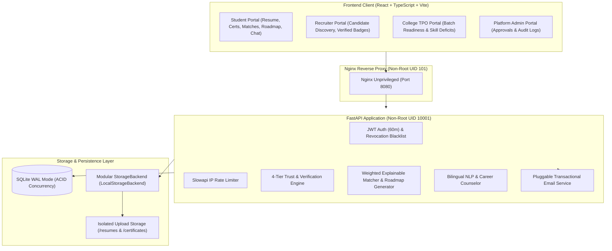

# 🎯 CareerLens: AI-Powered Verified Career & Internship Platform

> **Ending Resume Fraud with 4-Tier Multi-Modal Credential Verification, Explainable Match Scoring, and Bilingual AI Career Guidance.**

[](https://fastapi.tiangolo.com)
[](https://react.dev)
[](https://www.typescriptlang.org)
[](https://tailwindcss.com)
[](https://www.docker.com)
[]()
[]()

---

## 📌 Problem Statement

In campus recruiting and entry-level technical hiring:
1. **Resume Fraud & Exaggeration**: Up to **70% of resumes** contain unverified claims, forged certificates, or exaggerated skills.
2. **Black-Box Match Percentages**: Conventional platforms output an arbitrary percentage score without explaining **why** or **what is missing**.
3. **Language Barriers**: Talented students from diverse non-metro backgrounds struggle with English-only career advisory tools.
4. **Lack of Institutional Visibility**: College Training & Placement Offices (TPOs) lack real-time visibility into batch skill deficits and placement readiness benchmarks.

---

## 💡 Solution: What is CareerLens?

CareerLens is a verifiable talent platform connecting students, companies, and universities with an impenetrable trust layer:

- 🛡️ **4-Tier Credential Verification Engine**: SHA-256 duplicate hashing, QR authority lookup, OCR name consistency matching, and digital image Error Level Analysis (ELA) + PDF forensic tamper detection.
- 🎯 **Explainable Match Scoring**:
  $$\text{Match Score} = (0.45 \times \text{Verified Skills}) + (0.20 \times \text{Resume Skills}) + (0.15 \times \text{Academic Fit}) + (0.20 \times \text{Credential Depth})$$
- 🗺️ **4-Week Actionable Skill-Gap Roadmaps**: Automatically curates weekly sprints with hands-on projects to elevate student match scores to 90%+.
- 🤖 **Bilingual AI Career Counselor**: Native support for **English**, **Hindi (हिंदी)**, and colloquial **Hinglish**, grounded directly in the student's verified profile data.
- 💼 **Company Recruiter Discovery Portal**: Zero-fraud hiring portal allowing recruiters to filter exclusively by Gold/Silver verified badges and inspect forensic audit logs.
- 🏛️ **College / TPO Analytics Portal**: Live cohort analytics, batch placement readiness index, department benchmarks, and critical batch skill deficit reports.

---

## 🏗️ System Architecture



---

## 🔒 Production Security Hardening

| Security Domain | Implementation Details |
| :--- | :--- |
| **Authentication & JWT** | Access tokens expire in **60 minutes**. Token revocation endpoint (`POST /api/v1/auth/logout`) stores SHA-256 token hashes in the `revoked_tokens` table. Blacklisted tokens receive HTTP 401. |
| **Password Policy** | Minimum 8 characters with at least 1 uppercase letter, 1 lowercase letter, 1 digit, and 1 special character enforced on registration and reset. |
| **Rate Limiting** | `slowapi` enforces per-IP limits: Login (20/min), Register (5/min), Forgot/Reset Password (5/hr), Chat (15/min), Uploads (5/min). Exceeding limits returns **HTTP 429 Too Many Requests**. |
| **CORS Restriction** | Strict whitelist derived from `FRONTEND_URL` and `BACKEND_CORS_ORIGINS`. Unauthorized origins are denied cross-origin access. |
| **Security Headers** | `X-Content-Type-Options: nosniff`, `X-Frame-Options: DENY`, `Referrer-Policy: strict-origin-when-cross-origin`, and production `Strict-Transport-Security` (HSTS). |
| **File Upload Security** | Magic byte checks (`%PDF-` for resumes, image format validation for certificates), 10 MB file size limit (HTTP 413), and UUID filenames. Direct `/uploads` mount is disabled in favor of authenticated, RBAC-checked streaming endpoints. |
| **Test DB Isolation** | Automated assertion guard in `database.py` prevents tests from connecting to `careerlens.db`. Pytest executes against temporary `careerlens_test.db` and `/tmp` uploads with complete session teardown. |
| **Container Hardening** | Backend runs as non-root `appuser` (**UID 10001**). Frontend runs as non-root `nginx` (**UID 101**) on unprivileged port 8080. |

---

## 📦 Modular Storage Abstraction

All file operations route through a clean storage abstraction in `backend/app/services/storage.py`:

- **Interface (`StorageBackend`)**: Defines standard `save()`, `read()`, `get_path()`, `exists()`, and `delete()` contracts.
- **Implementation (`LocalStorageBackend`)**: Safely scopes files within `UPLOAD_DIR`, prevents path traversal, and manages `/resumes` and `/certificates` directories.
- **Future Cloud-Ready**: Ready for cloud providers (AWS S3, Google Cloud Storage) by implementing the `StorageBackend` contract without altering endpoint logic.

---

## 💾 Database Backup & Restore Automation

### 1. Live Non-Blocking Backup
Performs online backups using SQLite's backup API without blocking active readers or writers:
```bash
./scripts/backup_database.sh
```
- Validates backup with `PRAGMA integrity_check;`.
- Automatically retains the 14 most recent backups and prunes older archives.
- Backups are stored in `backups/` (gitignored).

### 2. Verified Safe Restore
Restores a backup to a target database with full integrity verification:
```bash
# Safe restore to a custom or scratch target:
./scripts/restore_database.sh backups/careerlens_backup_YYYYMMDD_HHMMSS.db /path/to/target.db

# Live production database restore (requires explicit confirmation flag):
./scripts/restore_database.sh backups/careerlens_backup_YYYYMMDD_HHMMSS.db backend/careerlens.db --confirm-live-overwrite
```
- Restores targeting the live database create a timestamped safety backup first.
- Safely removes stale SQLite WAL/SHM files during restoration.

---

## 🚀 Docker Deployment

### Prerequisites
- Docker Engine 24+ and Docker Compose v2+

### 1. Start Full Stack
```bash
docker compose up -d
```
- Frontend: `http://localhost:3000` (mapped to non-root Nginx port 8080)
- Backend API: `http://localhost:8000`
- API Documentation: `http://localhost:8000/docs`

### 2. Verify Container Health & Non-Root UIDs
```bash
# Check service health:
docker compose ps

# Verify non-root container users:
docker exec careerlens-backend-1 id    # uid=10001(appuser)
docker exec careerlens-frontend-1 id   # uid=101(nginx)
```

---

## ⚙️ Environment Variables Reference

Store secrets strictly in `.env` or your cloud secrets manager. Never commit `.env` files.

| Variable Name | Purpose | Default / Example |
| :--- | :--- | :--- |
| `SECRET_KEY` | Cryptographic secret for signing JWT access tokens | Random 256-bit hex |
| `ACCESS_TOKEN_EXPIRE_MINUTES` | Access token lifespan | `60` |
| `DATABASE_URL` | SQLite or PostgreSQL connection string | `sqlite:///./careerlens.db` |
| `UPLOAD_DIR` | Directory for stored files | `uploads` |
| `GEMINI_API_KEY` | Google Gemini API key for AI counselor | API key from Google AI Studio |
| `GEMINI_MODEL` | Gemini LLM model name | `gemini-2.5-flash` |
| `FRONTEND_URL` | Allowed frontend origin for CORS and password reset links | `http://localhost:3000` |
| `BACKEND_CORS_ORIGINS` | Comma-separated list of additional allowed origins | `http://localhost:3000,http://localhost:5173` |
| `ENVIRONMENT` | Deployment environment (`development` or `production`) | `production` |
| `PLATFORM_ADMIN_EMAIL` | Platform administrator account email | `superadmin@careerlens.io` |
| `PLATFORM_ADMIN_PASSWORD` | Platform administrator password (for deployment scripts) | Secure high-entropy password |
| `PLATFORM_ADMIN_PASSWORD_HASH` | Bcrypt hash for platform administrator | Precomputed bcrypt hash |
| `RESEND_API_KEY` | (Optional) Resend API token for transactional emails | `re_...` |
| `SENDGRID_API_KEY` | (Optional) SendGrid API key for transactional emails | `SG....` |
| `SMTP_HOST` | (Optional) SMTP relay host | e.g. `smtp.sendgrid.net` |
| `SMTP_PORT` | (Optional) SMTP relay port | `587` |
| `SMTP_USERNAME` | (Optional) SMTP relay username | `apikey` |
| `SMTP_PASSWORD` | (Optional) SMTP relay password / token | Provider API token |
| `SMTP_FROM` | Sender email address | `noreply@careerlens.io` |

---

## ⚠️ Known Limitations & External Requirements

### Real Transactional Email Delivery
- **Status**: `BLOCKED — PROVIDER CREDENTIALS REQUIRED`
- The `EmailService` is fully implemented and tested to support HTTP transactional providers (**Resend**, **SendGrid**) and authenticated **SMTP relays**.
- In local development, password reset links are recorded in an in-memory test inbox and logged cleanly without exposing secrets.
- In production, real email delivery to external user mailboxes requires valid provider credentials (`RESEND_API_KEY`, `SENDGRID_API_KEY`, or an authorized enterprise SMTP relay).

---

## 🧪 Demo Accounts for Evaluation

| Role | Email | Password | Description |
| :--- | :--- | :--- | :--- |
| **Student** | `student@careerlens.io` | `password123` | Aarav Sharma (IIIT) — 100% readiness, verified AWS & React credentials |
| **Recruiter** | `recruiter@careerlens.io` | `password123` | Sneha Rao (TechCorp) — candidate filtering, verification audits, job posting |
| **College / TPO** | `college@careerlens.io` | `password123` | Dr. Rajiv Kapoor (IIIT) — cohort analytics, batch readiness distribution |
| **Platform Admin** | `superadmin@careerlens.io` | *(Rotated)* | Dedicated admin for credential approvals, audit review, and overrides |

*(Note: In production environments, demo switching via `/api/v1/auth/demo-switch` is permanently disabled with HTTP 404. All demo accounts must authenticate via `POST /api/v1/auth/login`.)*

---

## 🧪 Test & Verification Results

```text
Backend Test Suite (Pytest):
======================= 82 passed, 2 warnings in 14.50s =======================

End-to-End User Journeys:
================================================================================
E2E TEST SUMMARY: 55 / 55 PASSED (0 FAILED)
================================================================================

Frontend Production Build:
✓ built in 1.10s (0 errors)
```
